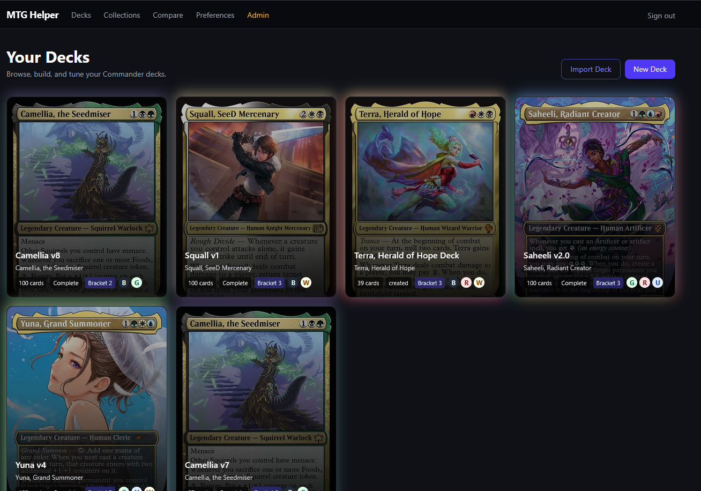
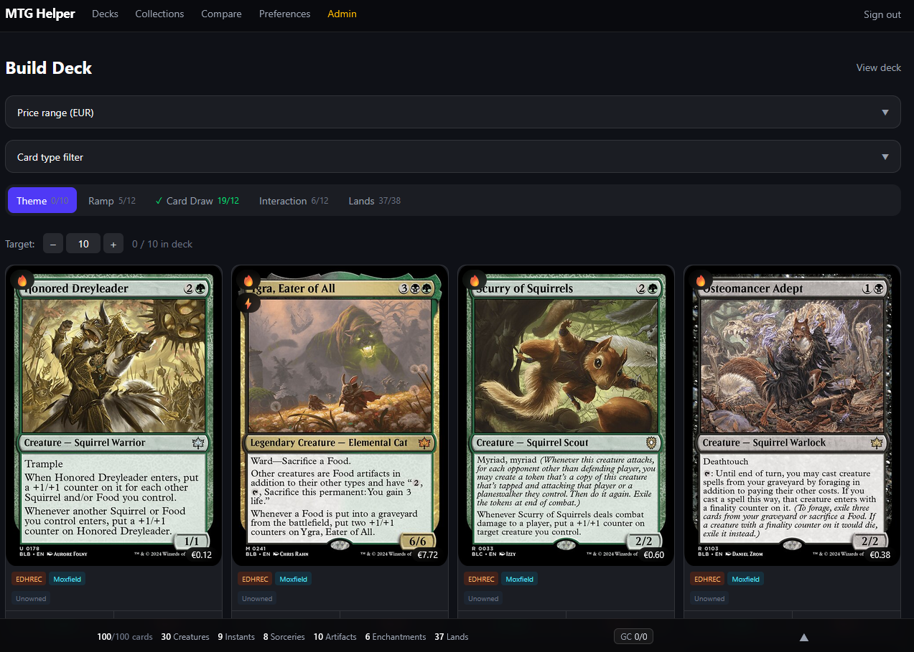
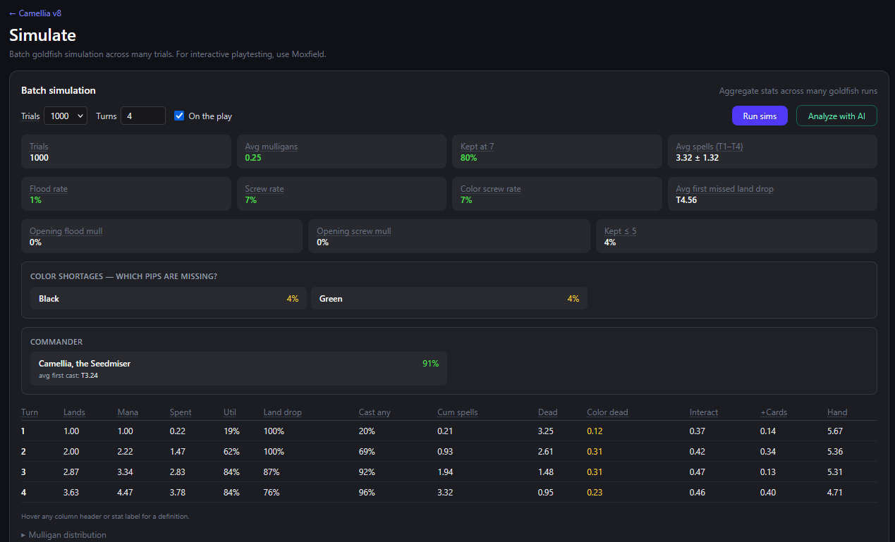

# MTG Helper

AI-assisted Commander deck building for Magic: The Gathering.

**Live app:** [https://mtg.marioweid.com](https://mtg.marioweid.com)  
_Requires Cloudflare whitelist access._

MTG Helper helps Commander players turn a deck idea into a playable list. Pick a commander, describe the strategy you want in natural language, search and add cards, refine the list with AI assistance, account for cards you already own, create Cardmarket buy lists for missing cards, and test opening hands and early turns with the built-in goldfishing tools.

## Screenshots

### Home / deck workspace



### Deck builder



### Goldfishing



## What it does

MTG Helper is built around one goal: make Commander deck building faster without removing the creative decisions from the player.

Instead of manually searching through thousands of cards, you can describe what you want the deck to do — for example, a token-copy strategy, a graveyard engine, a spellslinger shell, or a specific casual power bracket — and use the app to assemble, inspect, improve, and playtest the list.

The application combines a local Scryfall-backed card database, deck management workflows, AI-assisted recommendations, and Commander-specific tooling.

## Features

- **Commander-focused deck building** — Create and manage Commander decks with categories, card counts, commander sections, and legality-aware card data.
- **AI card coach** — Ask for card suggestions, swaps, strategy feedback, and improvements based on the deck you are building.
- **Natural-language deck direction** — Describe the deck's theme, plan, constraints, and preferred play experience.
- **Card search and details** — Search the local card database and inspect card images, rules text, color identity, mana value, and other metadata.
- **Deck refinement tools** — Review suggestions, compare changes, manage swaps, and keep the deck moving toward a coherent plan.
- **Goldfishing / playtesting** — Draw hands and simulate early turns to check whether the deck actually functions.
- **Mana and curve insights** — Inspect mana curve, color requirements, land balance, and deck composition.
- **Card collections** — Track owned cards so the app knows what is already available in your collection.
- **Collection-aware deck building** — Build and refine decks with ownership information in mind, including whether suggested cards are already owned.
- **Cardmarket buy lists** — Generate a buy list for missing deck cards that are not currently in your collection.
- **Moxfield-oriented workflows** — Import, export, and work with deck lists from existing Magic deck-building tools.
- **Fresh card data** — Scryfall bulk data is imported into PostgreSQL so card search and validation work locally.
- **Experimental New Cards** — Explicitly analyze recent, released Commander-legal cards for your physical deck. Review unverified advice alongside source rules, then plan an addition or dismiss it. No previews or automatic deck edits. See [setup and limits](OPERATIONS.md#experimental-new-cards-pilot).
- **Experimental Discover (default off)** — Source-backed, commander-only discovery with an optional strategy draft and explicit, bounded card generation. It does not assess physical-deck interactions. See [access and limits](docs/recommendation-pilot-contract.md).

## Compare and export cards

In **Planned changes**, use **Compare physical → planned** to preview additions and cuts without
applying them. Either comparison side can be physical, planned, or a snapshot; use **Swap sides**
to reverse the delta. Planned deck totals include commanders. Existing snapshots saved main-deck
cards only, so their commander configuration still comes from the current deck.

Use the shared **Selection** controls to select all changed cards, additions only, cuts only, or
clear the selection. Each group also has a bulk checkbox with a mixed state for partial selection;
toggling a group preserves other groups. Common cards can be selected separately for export only.
Counts distinguish unique cards from incoming/outgoing copies, including quantity increases/decreases.

Select changed rows and use **Plan selected additions** to queue incoming cards, or **Plan selected
changes** to include cuts and quantity decreases. Choose a target deck, review the preview and
confirm. Matching pending quantities are not duplicated, larger matching plans are preserved, and
opposite-direction plans are reported as conflicts rather than overwritten. Each card gets its own
result; failed cards can be retried without re-queuing successful ones. Common cards and commander
changes are excluded. This queues plans only; it never changes physical cards or binder inventory.
The planning actions and confirmation preview show in/out/net copy quantities, making balanced and
unbalanced swap selections explicit before queuing any plans.

Export incoming delta quantities (including increases), selected rows, or either full deck from
Compare. Planned changes also supports all or selected additions. Choose **MTGO text** or
**Cardmarket buy list**, then copy the list or download a TXT with one `quantity card name` per line.

Select binders under **Subtract cards from selected binders** to export only the remaining copies.
No binders selected means full quantities; leave proxy binders unchecked when buying real cards.
Alternate printings count together. The preview includes needed/available/exporting quantities,
a capped binder pull list, and estimated remaining EUR cost with missing prices flagged. Exports
never move or reserve inventory, apply planned changes, or place orders.

## Tech stack

- **Frontend:** Next.js, React, TypeScript
- **Backend:** Python 3.13, FastAPI, Pydantic, asyncpg
- **Database:** PostgreSQL 16
- **AI:** OpenAI Responses API / Pydantic AI integration
- **Tracing:** Optional self-hosted Assay (FastAPI, HTTPX, and AI content traces)
- **Local development:** Docker Compose
- **Deployment:** Portainer-friendly Docker Compose stack behind a reverse proxy / Cloudflare access layer

## Local development

Use Docker Compose with hot reload in either mode. See [`VERIFY.md`](VERIFY.md) for
configuration, safe database checks, tests, and switching modes.

- **Isolated (default):** `docker compose up -d --build` uses a local database. Use this
  for tests, schema changes, and migration experiments before committing or deploying.
- **Live data:** `docker compose -f docker-compose.yml -f docker-compose.live.yml up -d --build`
  uses the homeserver database and existing Google accounts, decks, and collections.
  **Edits/deletes immediately affect production.** Startup schema changes, catalog
  initialization, and global deck repairs are skipped, not ordinary application writes.
  The local PostgreSQL container remains separate for tests.

```bash
# Copy the backend environment file used by local Compose (it remains outside images).
cp backend/.env.example backend/.env
$EDITOR backend/.env  # set OPENAI_API_KEY
cp .env.example .env
$EDITOR .env  # set Google credentials, a unique local AUTH_SECRET, and optional live DSN

# start Postgres, backend, and frontend
docker compose up -d --build

# follow logs
docker compose logs -f backend frontend
```

Default local services:

| Service | URL |
|---|---|
| Frontend | http://localhost:3000 |
| Backend API | http://localhost:8000 |
| Isolated PostgreSQL | localhost:5432 |

All published development ports bind to `127.0.0.1`. Google must allow the redirect
`http://localhost:3000/api/auth/callback/google`; the same Google client ID is supplied
to both local frontend and backend. Real `.env` files stay outside version control.

Stop the stack with:

```bash
docker compose down
```

See [`OPERATIONS.md`](OPERATIONS.md) for production deployment, data sync, Portainer setup, and operational commands.

To connect an existing Assay instance, set `ASSAY_ENDPOINT`, `ASSAY_API_KEY` (project ingest key),
and `ASSAY_APPLICATION` (application slug) on the backend. Assistant follow-up turns are grouped
by chat in Assay's **Sessions** view. See
[Assay tracing setup](OPERATIONS.md#assay-tracing) for Portainer, networking, and privacy details.

## Development checks

Backend:

```bash
cd backend
uv run ruff check .
uv run ruff format --check .
uv run ty check src/
# Prepare the isolated test database first; see VERIFY.md.
uv run pytest -q
```

Frontend:

```bash
cd frontend
pnpm install
pnpm test
pnpm typecheck
pnpm lint
pnpm format:check
pnpm build
```

## Project documentation

Start with the [documentation guide](docs/README.md) for current runbooks, pilot contracts,
unfinished work, and clearly separated historical evidence. Implementation guides:

- [Overview](projects/mtg-helper/overview.md)
- [Architecture](projects/mtg-helper/architecture.md)
- [API design](projects/mtg-helper/api-design.md)
- [Data model](projects/mtg-helper/data-model.md)
- [Workflows](projects/mtg-helper/workflows.md)
- [Remaining work](projects/mtg-helper/roadmap.md)
- [Tech stack](projects/mtg-helper/tech-stack.md)

## Status

This is an active personal project. The public URL is protected and only available to whitelisted users through Cloudflare access controls.
